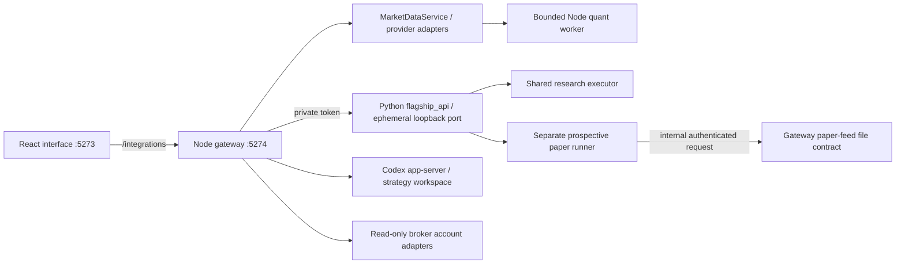

# Q V2 architecture audit

Source inspection, 2026-10-04. Scope: this checkout only. Q is the active product; `q21`, `flagship`, and `evidence` remain compatibility identifiers. This map describes reachable code and its limits, not measured performance, successful provider authentication, or live connectivity. Test execution and runtime acceptance belong to the accompanying audit record.

**Implemented** means a concrete code path exists. **Partial** means a useful path exists but the complete workflow still needs integration or external acceptance. **UI-disabled** means the interface deliberately prevents an unsupported action. **Planned** means the required service is absent. **Historical** means retained compatibility/reference code outside the active launcher path. Empty states, unavailable data, and disabled execution controls are not fabricated calculations.

## Process and request ownership

[`start-q21.ps1`](../start-q21.ps1) owns startup: web port 5273 and gateway port 5274 by default, with distinct-port validation, existing-listener rejection, and gateway PID ownership verification. It pins `Q_FLAGSHIP_DATA`, `Q_PAPER_DATA`, and `Q_ENGINE_PYTHON` to this checkout, then restores inherited variables on exit. This prevents inherited V1 paths from redirecting launcher-managed writes. Directly launching services can still use their documented environment overrides.

[`apps/web/vite.config.ts`](../apps/web/vite.config.ts) binds the development server to loopback and proxies `/integrations` to the configured gateway. It retains the Sites plugin and hosting manifest. The hosting configuration is not evidence that the local Python engine, private files, broker sessions, or Codex process are deployed to Sites.

[`createGateway` and `allowedRequest`](../apps/gateway/server.mjs) enforce loopback peers, allowed Host/Origin values, and JSON mutation requests. [`EngineBridge.start/forward/history`](../apps/gateway/engine.mjs) launches `apps/engine/serve.py`, restricts forwarded routes to the research/portfolio/evidence/health/paper API families, injects a random engine token, and bounds request sizes and timeouts. [`serve.py`](../apps/engine/serve.py) binds an ephemeral loopback port and exits when the gateway owner pipe closes. [`flagship_api.local_gateway_only`](../apps/engine/flagship_api.py) checks the token. These are local-process boundaries, not a public multi-user authorization system.

The bridge can start Python on demand; the normal gateway entrypoint also calls `startPaperRunner`, so startup attempts to make the independent paper runner available without an open browser. A running process does not establish that a provider feed or account is ready.

## Reachable research paths

[`app/page.tsx`](../apps/web/app/page.tsx) renders [`Terminal`](../apps/web/components/terminal.tsx). Navigation selects local components; `ResearchView` loads research components on first visit and preserves drafts while hiding inactive views. The research workflow cue in [`research-workspace.tsx`](../apps/web/components/flagship/research-workspace.tsx) directs users from mandate and data through validation, experiment history, and prospective validation. It is navigation guidance, not an additional calculation engine.

| Entry and transport | Actual computation and record | Classification and boundary |
| --- | --- | --- |
| Markets/Data → [`useMarketData`](../apps/web/hooks/use-market-data.ts) → `/integrations/market/catalogue`, `/market/history`, `/market/import` | [`MarketDataService.catalogue/history/importCsv`](../apps/gateway/market-data.mjs); providers described below | Implemented historical-data workflow. `quoteFromDataset` displays the last historical close; its `Quote` type is not a live quote service. |
| Strategies/Backtests → `Terminal.run` → `/integrations/backtests` | `MarketDataService.run` → [`QuantPool.run`](../apps/gateway/quant-pool.mjs) → [`quant-worker.mjs`](../apps/gateway/quant-worker.mjs) → [`quant.backtest`](../apps/web/lib/quant.ts) | Implemented fixed-template daily research. Results require a dataset and retain strategy/data identity. Custom Codex source is not loaded into this engine. |
| Portfolio engineering → [`researchApi`](../apps/web/lib/flagship/research.ts) → `/integrations/engine/api/research/runs` | [`ResearchWorkspace.submit/_execute`](../apps/engine/apps/research_api.py) → [`run_research`](../apps/engine/research/workspace.py) and research/backtesting modules | Implemented asynchronous experiments, archived inputs/results, comparisons, and decision history. Available sleeves come from `strategy_catalog`; unavailable strategies are disclosed. |
| Strategy Survival → [`survival-dashboard.tsx`](../apps/web/components/flagship/survival-dashboard.tsx) → `/api/research/survival/*` | [`SurvivalService.submit/_execute`](../apps/engine/research/survival/service.py) and [`run_pipeline`](../apps/engine/research/survival/pipeline.py) | Implemented evidence calculations with PASS/WARN/FAIL/N-A states. A research gate is not execution permission; absent forward/live evidence remains unavailable. |
| Allocation replay → [`allocation-replay.tsx`](../apps/web/components/flagship/allocation-replay.tsx) → `/api/portfolio/analyze` | [`flagship_api.portfolio`](../apps/engine/flagship_api.py) → [`analyze_portfolio`](../apps/engine/portfolio/custom.py) | Implemented historical weighted-portfolio analysis; browser-saved portfolio definitions remain origin-specific. |
| Trading lab, Market making, Advanced research, Library → [`EvidenceWorkspace`](../apps/web/components/flagship/evidence-workspace.tsx) → `/api/evidence/catalog`, `/actions/*`, `/artifacts/*` | [`flagship_api.action/submit`](../apps/engine/flagship_api.py) → `evidence` modules or [`qresearch.service.ACTIONS/run`](../apps/engine/qresearch/service.py) | Implemented queued studies and stored artifacts. Market making is an explicitly synthetic event model; advanced models retain their own assumptions. |

These paths do not share one accounting model. Terminal daily research uses share accounting; portfolio engineering uses fractional weights; allocation replay uses provider-adjusted history; strict daily, bar, options, and event engines have their own contracts. See [data conventions](real-market-data.md), [operation/accounting map](flagship.md), and [Survival methodology](strategy-survival.md) before comparing outputs.

## Data acquisition and provenance

[`MarketDataService`](../apps/gateway/market-data.mjs) fetches Nasdaq/NSE catalogues, deduplicates concurrent requests, distinguishes cached/unavailable responses, and maintains provider-specific latest pointers. `saveDataset` hashes instrument, source, price basis, and input bars (including embedded corporate-action fields); existing dataset versions are reused. `run` combines strategy, dataset ID, and engine identifier for result identity. CSV import requires an explicit source and raw-price declaration; that declaration does not authenticate the supplied observations.

[`MassiveAdapter`](../apps/gateway/massive.mjs) owns Massive access in Node. Python calls the gateway's token-protected `/internal/market-history` route through [`load_provider_ohlcv`](../apps/engine/data/provider_history.py); credentials need not travel in that request. Terminal Massive history retains raw bars and actions, while Python portfolio/lab adapters consume split-adjusted units and exclude cash dividends.

Yahoo and explicitly synthetic terminal history go through `EngineBridge.history` → `flagship_api.market_history` → `data.provider_history.terminal_history`. Yahoo loading is implemented in [`data/research_source.py`](../apps/engine/data/research_source.py). The synthetic path has a deterministic seed and fixed end date, and labels weekday observations as artificial. Provider failure does not select it implicitly. Lab downloads also use [`evidence/lab_data.py`](../apps/engine/evidence/lab_data.py); strict historical Angel access is separate in [`evidence/provider.py`](../apps/engine/evidence/provider.py).

**Partial:** provider adapters and error handling exist, but installed code does not establish credentials, entitlements, network availability, complete delisting coverage, historical membership, or independently verified calendars. Historical-data access does not satisfy the prospective paper-feed contract.

## Persistence and bounded work

| Owner/store | Contents and mutability |
| --- | --- |
| Browser `q21-workspace-real-v2` in [`Terminal`](../apps/web/components/terminal.tsx) | Strategy drafts, up to 20 displayed saved results, legacy local paper-account state, and notes. The older `q21-workspace-v1` remains exportable. Browser state is not the authoritative paper ledger. |
| `.data/market`, [`MarketDataService.read/write/saveDataset/run`](../apps/gateway/market-data.mjs) | JSON catalogue caches, content-addressed dataset files, mutable latest pointers, and backend backtest records. Writes use temporary files plus rename. This is a file store, not SQLite. |
| `.data/flagship/experiments/<run>`, [`ExperimentTracker`](../apps/engine/research/experiment_tracker.py) and `ResearchWorkspace` | `experiment.json`, mutable job/progress/decision metadata, and completed result/data/source artifacts. New runs preserve earlier study outputs; reuse verifies archived input hashes. These files are not protected by SQLite immutability triggers. |
| `.data/flagship/evidence/registry.sqlite`, [`Store`](../apps/engine/evidence/storage.py) | Content-addressed artifacts, append-only events, holdout records, and transition history; update/delete triggers reject artifact/event mutation. |
| `.data/flagship/survival/registry.sqlite`, `SurvivalService` using `Store` | Frozen input/source bytes, trial history, per-layer events/results, and manual forward records. It does not silently rewrite the parent research result. |
| `.data/paper/paper.sqlite`, [`Ledger`](../apps/engine/paper/storage.py) | Transactional checkpoints and hash-linked append-only events, with immutable input/source snapshots. `export` verifies chain/config/input identity and checkpoint reconstruction. This verifies local consistency, not vendor truth. |
| `.data/codex-development/<id>`, [`StrategyDevelopment`](../apps/gateway/strategy-development.mjs) | Editable workspace, project metadata, and hash-addressed source snapshots. Snapshot files use exclusive creation; later edits make new versions. |

The active Python scheduler is [`ResearchWorkspace.executor`](../apps/engine/apps/research_api.py): one worker, at most three queued/running calculations. Portfolio analysis, Evidence actions, and Survival share its lock/admission counter through `flagship_api` and `SurvivalService`; excess work returns HTTP 429. Restart marks unfinished jobs failed/interrupted rather than claiming continuation. This is an in-process local scheduler, not a durable distributed job queue or a limit on every HTTP request.

The independent Node [`QuantPool`](../apps/gateway/quant-pool.mjs) has one lazy worker and three-job admission. Current V2 fixes associate each job with its owning worker, so a late exit from a failed worker cannot reject its replacement's work; failed serialization releases capacity, and closing settles outstanding jobs. [`quant-pool.test.mjs`](../apps/gateway/tests/quant-pool.test.mjs) covers those cases. Test presence is not a test-run result.

[`qresearch.modeling.forecast`](../apps/engine/qresearch/modeling.py) imports ARIMA inside the requested action and converts unavailable imports/native-library errors into an explicit job failure. Catalogue/frontier loading does not require that ARIMA import; [`test_qresearch_optional_dependencies.py`](../apps/engine/tests/test_qresearch_optional_dependencies.py) records that contract. This isolates one optional dependency failure; it does not make every Python dependency optional.

## Paper accounts and broker boundaries

[`PaperTrading`](../apps/web/components/paper-trading.tsx) calls [`paperApi`](../apps/web/lib/paper-trading.ts) → `/integrations/engine/api/paper/*` → [`paper.api`](../apps/engine/paper/api.py). [`PaperService`](../apps/engine/paper/service.py) owns registration, readiness, lifecycle, scheduling, decisions, and modeled accounting; [`paper/accounting.py`](../apps/engine/paper/accounting.py) owns cash, shares, orders, fills, and corporate actions. The runner has its own thread rather than occupying the research executor. All execution remains `q_simulated` with `broker_verified` false.

`paper.api.freeze` resolves completed research mandates and custom source versions from server storage. Terminal and allocation adapters instead validate and freeze submitted parameters under their supplied reference; they do not independently resolve that reference to a market-result file or browser portfolio record. The frozen deployment protects subsequent execution from editor changes, but those two adapters do not prove an end-to-end saved-artifact link.

**Partial:** prospective simulation is implemented, but activation needs an externally configured raw feed. [`paperFeed`](../apps/gateway/paper-feed.mjs) reads `.data/paper-feeds/<provider>-<market>-<interval>.json` through an authenticated internal route. [`paper.models.Feed`](../apps/engine/paper/models.py) and `PaperService` enforce feed/calendar/action/receipt constraints. No historical cache or synthetic fallback fills this role. A vendor publisher is not supplied by the selected Massive/Alpaca connection stage.

**Partial:** custom paper adapters have a concrete optional execution path in [`paper/worker.py`](../apps/engine/paper/worker.py): validated frozen files, a pinned locally installed image, Linux Docker, no network/host mounts, and bounded resource/time/output limits. Missing runtime/image/adapter blocks activation. Source inspection does not verify a particular host's container isolation.

[`AngelOneAdapter` and `IbkrAdapter`](../apps/gateway/brokers.mjs) implement authenticated read-only snapshots. [`AlpacaPaperAdapter`](../apps/gateway/alpaca-paper.mjs) permits only the fixed paper host and three GET resources: account, positions, and latest 100 orders. Its status explicitly returns `automatedDeploymentEnabled: false` and `liveOrderSubmission: false`. No adapter exposes a live order-submission route.

**UI-disabled:** the terminal Execution view is an explicit unavailable state. The old [`lib/paper.ts`](../apps/web/lib/paper.ts) order function is retained but not called by `Terminal`; its visible account/risk/kill-switch state is distinct from persistent Deployments. It must not be read as control over `PaperService` or a broker. **Planned:** broker paper order routing, durable broker reconciliation, independent deployment-to-broker-account mapping, and the production risk/compliance/settlement/approval system needed for live execution. Read-only connection success would not complete any of these.

## Codex development boundary

The UI's integration hook sends project/chat requests to [`server.mjs`](../apps/gateway/server.mjs), which allowlists research context fields and streams actual Codex events. [`CodexGateway`](../apps/gateway/codex.mjs) talks to a local authenticated Codex app-server, serializes development mutations, and reports unavailable/login-required states when it cannot initialize. It does not fabricate an AI answer.

[`StrategyDevelopment.create/snapshot/parameters/attach`](../apps/gateway/strategy-development.mjs) creates a separate Git workspace, attaches selected immutable datasets, and snapshots before/after development turns and parameter edits. Custom development is separate from fixed-template backtesting. Scoped permissions, credential-variable stripping, disabled network/apps/MCP tools, and rejected escalation requests are present. As [implementation.md](implementation.md) states, native Windows read isolation is not a complete filesystem security boundary. Development output is reviewable code, not implicit execution approval.

## Retained and obsolete paths

- [`apps/engine/legacy_evidence`](../apps/engine/legacy_evidence/README.md) is the historical standalone UI/packaging reference. Its commands and policy history do not define Q's active startup. [`evidence/jobs.py`](../apps/engine/evidence/jobs.py) is its separate job helper; active Q uses the shared scheduler described above.
- [`apps/engine/apps/portfolio_api.py`](../apps/engine/apps/portfolio_api.py) is a retained standalone API, also used by legacy-oriented tests. `start-q21.ps1` does not launch it. The disconnected research screen's old port-8000 command was corrected during this audit to `setup-flagship.ps1` followed by `start-q21.ps1`.
- [`apps/web/app/api/markets/route.ts`](../apps/web/app/api/markets/route.ts) and [`api/backtests/route.ts`](../apps/web/app/api/backtests/route.ts) are compatibility redirects to the gateway, not parallel data/calculation services.
- [`apps/web/db/schema.ts`](../apps/web/db/schema.ts) is empty and [`db/index.ts`](../apps/web/db/index.ts) is unused by the audited active flows. This Sites/D1 scaffolding is not the research or paper database; preserve the hosting manifest/plugin.
- [`qresearch/origins`](../apps/engine/qresearch/origins/__init__.py), source manifests, migration code, and explicitly labeled full-library synthetic runs preserve lineage. The retained full-sample pair-selection scenario is historical diagnostic code, not proof of causal validation. The original product specification, when available locally, is planning history rather than an implemented-capability inventory.

The next architectural work is integration of the missing prospective publisher and broker-paper lifecycle, with explicit artifact linkage and external acceptance. It is not enabling the disabled live-order controls. Existing results and historical source projects must remain preserved while those boundaries are developed.
