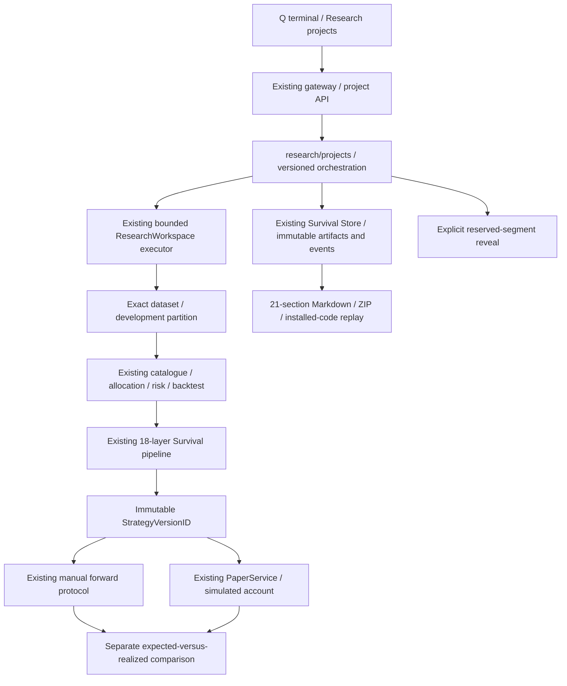

# Q single-strategy research lifecycle

## Architecture audit before implementation

This extension builds on the code traced in [the V2 audit](v2-audit.md), [architecture map](audit-architecture.md), [implementation](implementation.md), [Survival methodology](strategy-survival.md), and [paper service](paper-trading.md). Q remains one application. V1 remains unchanged.

The existing `ResearchWorkspace` owns bounded execution, fixed-catalogue strategy experiments and archived result/data/source files. `pipeline_for` composes strategies, allocation, volatility/exposure limits and the drifting fractional backtester. `SurvivalService` adds 18 diagnostic layers, prior-trial records, immutable SQLite artifacts, manual forward records and exact export replay. `PaperService` has frozen simulated deployments, feed readiness, deterministic accounting, monitoring and an append-only ledger. The terminal already has shared panels, tables, result views and Survival controls.

Missing before this extension: a first-class single-strategy project, immutable hypothesis revisions, literature references, project-linked reasons/inspection history, a reserved project holdout, formal candidate freeze, an integrated comparison/report, and lifecycle navigation. Ordinary research experiment files are not an immutable database; project evidence must capture completed results and verify archived bytes.

## Reuse map and implementation plan

| Capability | Treatment | Reason |
| --- | --- | --- |
| Strategy catalogue, signals, backtest, risk and portfolio constraints | REUSED | One calculation engine; no duplicate strategy framework. |
| Research job queue and snapshot input | EXTENDED | Submit project trials using an exact in-memory archived bundle; preserve existing callers. |
| Survival statistics, robustness, regimes and execution stress | REUSED | Preserve PASS/WARN/FAIL/N-A and DSR prerequisites. |
| Immutable artifact/event storage | EXTENDED | New versioned project artifact kinds and an additive migration marker in the existing registry. |
| Hypothesis, signal documentation, literature, decision and inspection lineage | NEW | Project orchestration metadata, not a calculation engine. |
| Dataset capture and reserved chronological final segment | NEW orchestration | Reuse provider loaders and existing bundle/calculation methods; exclude the reserved segment from development trials. |
| Strategy freeze and reproducibility manifest | NEW orchestration | Bind exact hypothesis, data, experiment, validation, source, expectations and kill criteria. |
| Forward evidence and automated paper account | REUSED / EXTENDED | Link existing manual registrations or existing paper deployments to an immutable project freeze. |
| Expected versus realized comparison and alerts | NEW orchestration | Compare separately labeled stored evidence; unavailable metrics remain null. |
| Markdown investigation export | NEW | Assemble stored artifacts and authored interpretation without invented conclusions. |
| Terminal project workspace | NEW integrated view | Reuse Q navigation, API transport, controls and result components. |

## Integrity boundaries

Projects use one catalogue strategy. New material changes create revisions; old trials, failures, freezes and forward registrations remain. Regime analysis is diagnostic by default. Enabling regime conditioning changes the specification and requires new evidence.

The project-reserved final segment is withheld from development calculations. Revealing it consumes that project holdout and is journaled before computation. This cannot establish that the researcher never saw the same public history elsewhere. Labels must distinguish a locally sealed retrospective holdout, pseudo-OOS, walk-forward and prospective observations; genuine unseen historical status remains unknown without independent provenance.

Identical dataset bytes retain the same development/reserved cutoff across recaptures, including after a reveal. Reducing the holdout would expose previously reserved observations; increasing it would relabel development as reserved. Both changes are rejected. Older conflicting captures remain readable but block further trials, validation, reveal, freeze and new forward registration through those records. This guard covers identical datasets in one project; different snapshots/universes and other projects still require an honest prior-exposure assessment. It is not a global embargo on overlapping market history.

The research and paper strategy adapters now share five weighting choices: signal, equal, inverse volatility, risk parity, and minimum variance. They reuse existing allocators before the existing exposure and volatility controls. Covariance methods require long-only signals. Position caps, residual cash and volatility targeting can change exact risk contributions. Minimum variance uses the existing mean-variance optimizer with zero expected returns; its feasible fallback is not a claim of a globally optimal solution. The estimation window is 20–126 bars, within the existing warm-up requirement. Production calendars, calibrated impact, point-in-time constituents, authenticated forward feeds and live orders are not supplied by a project record.

The example uses explicitly seeded synthetic momentum data. It can freeze a mechanics demonstration and register an empty manual forward protocol, but cannot activate a market paper deployment or invent a prospective track record.

## Module and data flow



`models.py` owns strict API contracts. `service.py` manages lineage and invokes existing services. `monitoring.py` compares evidence, and `report.py` assembles exports. `replay.py` verifies an export and reruns the existing calculations. The UI is `components/flagship/research-projects.tsx`, with the specification editor and typed transport separated. No new strategy engine, worker pool, account simulator, broker route or hosting application was introduced. `paper.api.evidence_for` is a small refactor of the existing evidence endpoint for reuse.

## Database changes and immutable lineage

Schema migration **1** is additive: `research_project_migrations(version INTEGER PRIMARY KEY, applied_at TEXT NOT NULL)`. Existing SQLite `artifacts` and `events` tables retain their content addressing and update/delete prevention triggers. Opening the project module preserves existing research/Survival rows and refuses an unknown newer migration. No historical files or results are rewritten.

| Artifact kind | Contents and links |
| --- | --- |
| `research_project` | Creation time, schema version, unique investigation identity |
| `project_revision` | Parent revision, full thesis/signal/portfolio/statistical specification, archived catalogue algorithm text, reason and post-OOS flag |
| `project_reference` | Citation, authors/year/DOI/URL, findings/assumptions, replication status and optional trial link |
| `project_dataset` | Exact OHLCV and benchmark CSV bytes, metadata, checksum, source request, capture time and chronological partition |
| `project_task` | Dataset/OOS task identity; queued/running/completed/failed events |
| `project_trial` | Revision/dataset, exact executable request, reason, prior inspected trials, post-OOS status |
| `project_evidence` | Sealed result, development snapshot, targets, executed weights, NAV and archived-source reference |
| `project_oos` | Candidate, partition, source identity, reserved returns and metrics, explicit retrospective label |
| `project_freeze` | StrategyVersionID is its content hash; binds revision, trial, data, source, validation, expectations and kill criteria |
| `project_forward` | Frozen version linked to an existing manual protocol or persistent paper deployment |

Every change appends a timestamped event. The journal records hypothesis changes, captures, attempts, admission/calculation failures, result exposure, decisions, validation outcomes, reveals, freezes, forward events, paper controls and report exports. GET results conservatively records their exposure once; it does not claim to measure human attention. Restarted unfinished tasks become retained failures. Stale editor revisions return 409. All explicit parameter attempts remain, including queue rejection; batches larger than available capacity should be resubmitted deliberately with their original failures visible. The shared queue still admits at most three computations.

## Methodology, OOS and freeze semantics

1. Write one falsifiable catalogue-strategy hypothesis with mechanism, failure conditions, metrics, criteria and limitations. Notes explain interpretation; executable behavior remains the versioned request and archived implementation.
2. Capture a dataset before experiments. The default final 20% (configurable 10–30%) is reserved; development must support the existing walk-forward windows. Data lineage records selected-universe and corporate-action limitations. Data GET/export omits reserved bars until reveal.
3. Run development trials. The engine receives only the development prefix. Lookback perturbations, cost/rebalance overrides and revisions retain distinct records. The Survival pipeline separately retains every local parameter diagnostic; the overview reports those attempts independently from explicit trials.
4. Run the existing Survival protocol. Its train/validation/test and rolling/expanding evaluations operate inside the development prefix. They do not consume the project's final reserved segment. See [statistical methods](strategy-survival.md) and [V2 numerical conventions](v2-methodology.md). Integrity failures, configured FAIL gates, WARN and N-A retain their existing meanings. Default required evidence is integrity, not universal statistical approval. Prose acceptance criteria require researcher judgment.
5. Reveal the final segment once. The access event is recorded before calculation, including failed calculations. Revealing the same full dataset again within that project is blocked even after recapture. New revisions and trials after any reveal are marked post-OOS. Previously inspected/imported history is pseudo-OOS. Q cannot certify private/external exposure or prevent a user from examining their own SQLite files; **genuinely unseen historical status remains UNKNOWN**.
6. Freeze the exact current candidate after compatible completed validation and satisfied configured gates. Perturbed candidates must first become a versioned specification and be rerun. A rejected candidate needs an explicit reviewed decision. Trial, validation and source identities must agree. Hashes protect sealed evidence if ordinary experiment files are changed. A freeze is not an investment approval and need not imply all 18 layers passed.
7. Register forward evidence for that immutable version. A later revision cannot change a deployed request. One registration per mode per version prevents resetting an unfavorable record. Every material change requires a new freeze and new prospective record.

Regime analysis remains diagnostic unless the saved specification explicitly enables conditioning; changing that choice creates a new revision. Historical adjusted daily fractional research, whole-share stress and raw-price prospective paper accounting are different models. Comparisons keep those conventions visible.

## API contracts

All endpoints use `/api/research/projects` through the existing authenticated loopback gateway (`/integrations/engine/api/research/projects` in the web client). Pydantic rejects unknown fields and nonfinite values. Actions with reasons require at least ten characters.

| Method / suffix | Contract |
| --- | --- |
| GET / POST root | Project index / `{spec}` creates a project (201) |
| GET `/catalog` | JSON specification schema, existing catalogue, weighting methods and unsupported features |
| GET `/{project}` | Full lineage, tasks, retained trials, diagnostics, OOS, freezes and journal; no reserved raw bars |
| POST `/{project}/revisions` | `{parent_revision, spec, reason}`; stale parent 409 |
| POST `/{project}/references` / `/notes` | Structured reference / `{reason}` journal note |
| POST `/{project}/datasets` | `{reason, prior_run_id?}`; asynchronous exact capture (202) |
| POST `/{project}/trials` | `{revision_id, dataset_id, reason, lookbacks?, rebalance?, commission_bps?, slippage_bps?}`; all attempt IDs (202) |
| POST `/{project}/trials/{trial}/validate` | Existing Survival submission using revision protocol (202) |
| POST `/{project}/trials/{trial}/decision` | `{status: rejected or watchlist, rationale}`; project paper selection uses freeze |
| POST `/{project}/trials/{trial}/reveal` | `{reason}`; irreversible access event and queued OOS evaluation (202) |
| POST `/{project}/freezes` | `{trial_id, validation_id, reason, expected_metrics, expectation_basis, kill}` (201) |
| GET `/{project}/versions/{version}/comparison` | Distinct historical/walk-forward/OOS/forward metrics and alerts |
| POST `/{project}/forward` | `{strategy_version_id, mode: manual or automated, provider?, reason}` (201) |
| POST `/{project}/forward/{record}/events` | Existing strict manual `PaperEvent` contract, observed-data versions only |
| POST `/{project}/forward/{record}/control` | Existing paper control `{action}`; readiness/transition guards retained |
| GET `/{project}/report` / `/export` | Markdown / ZIP download |

## UI and prospective monitoring

Open **Research projects**, Q's default workspace. Lifecycle stages are THESIS, DATA, SIGNAL, EXPERIMENTS, COMPARE, VALIDATION, ROBUSTNESS, OOS, FREEZE, FORWARD, MONITOR and PAPER. The overview shows current candidate, every explicit trial, failed attempts, diagnostic parameter attempts, DSR/PBO availability, revealed OOS and frozen versions. Robustness displays the full local lookback table rather than selecting an optimum. The existing chart shows portfolio and benchmark with distinct fixed colors; return cells use positive green, negative red and neutral unavailable values.

COMPARE presents two to four retained trials, including failures and rejected candidates. It shows historical and walk-forward metrics, costs, risk, stress, validation status, DSR/PBO prerequisites and fingerprints. Only curves with matching data, dates, source, currency/benchmark and execution/account conventions are overlaid. Values are divided by recorded initial capital; the initial NAV and first-period loss are preserved. Dates are never trimmed or filled to force compatibility. Unequal comparisons retain their evidence tables and specific incompatibility reasons. No ranking, optimizer, fresh calculation or additional significance claim is introduced.

Project fetches are owned by the active investigation; stale responses cannot replace a newly selected project or blank draft. Forward and monitoring views refresh every five seconds while visible, clear stale results on request failure, and retain distinct manual/automated evidence. The OOS panel describes the selected trial's dataset, independently of the dataset selected for a future trial.

FORWARD can register a manual protocol or create a draft in the existing automated simulator. Automated registration requires observed data, original mandate gates, long-only cash-compatible limits and the installed source matching the freeze. Activation independently requires the existing explicit feed/calendar/settlement/corporate-action readiness checks. A registered draft is not a connected feed. Synthetic examples allow only an empty manual protocol and reject manufactured forward marks.

MONITOR compounds actual recorded returns and includes initial NAV in drawdown. Gross exposure comes from the latest manual observation or current simulated account positions. Drawdown, gross exposure, cost drift, stale evidence and pipeline exceptions generate explicit review alerts. Existing paper service risk halts retain their own behavior; project alerts do not automatically stop accounts or issue orders. Manual and automated series remain separately identified when both exist. There is no aggregate prospective column for mixed records.

## Reports and reproducibility

PAPER exports the requested 21-section research draft. Authored thesis/references/notes are separate from calculated metrics. Unwritten interpretation and conclusions are marked as such. Failed attempts, validation caveats, OOS exposure and forward records are retained. The ZIP contains a file-checksum manifest, project JSON, each completed development experiment's data/targets/holdings/NAV/source, nested existing Survival exports and immutable freeze manifests. Full dataset snapshots are included only after reveal.

From `apps/engine`, with the recorded dependencies and matching reviewed source:

```powershell
.\.venv\Scripts\python.exe -m research.projects.replay C:\path\to\research-project.zip
```

Replay verifies all file checksums and installed source/dependency identity, reruns development targets/executed holdings/NAV and revealed OOS, and invokes exact existing Survival replay. Development arrays use disclosed floating-point tolerances (weights/returns 1e-12, NAV absolute 1e-8); OOS metric and Survival result hashes remain exact. No archived code is executed automatically. Prospective observations are not recreated by historical replay. After code changes, review the included source archive and reproduce in a separate matching environment; a new engine cannot silently represent itself as an old one.

## Fixed example and verification

```powershell
cd C:\quant\terminal-v2\apps\engine
.\.venv\Scripts\python.exe -m scripts.single_strategy_example
```

This creates a fresh directory under `outputs/project-example`, a seeded eight-instrument momentum study (63-bar lookback, weekly schedule, regime conditioning off), 720 development observations, 180 reserved observations, all 18 validation layers, one reveal, immutable freeze and empty forward protocol. It exports `summary.json`, `research-paper.md` and `research-project.zip`. It does not tune parameters to obtain favorable evidence. This isolated example is distinct from project records created through the running UI.

Tests in `test_research_projects.py` cover versioning/stale edits, hashes, dataset exclusion, failed trial retention, ownership, reveal history, immutability, freeze/decision rules, prospective separation, additive migration, persistence/readiness, numerical comparisons, reports, API contracts and full ZIP replay. `test_project_allocations.py` tests future-data perturbations, inactive signals, analytic two-asset solutions, compatibility defaults and paper/research target equality. Existing paper tests cover next-bar fills, cash, settlement, restart, deduplication, errors and account controls. Run `verify-v2.ps1` for all Python/web/gateway tests, TypeScript and the production build. [Executed verification](single-strategy-verification.md) records 430 passing cases, successful browser acceptance and both final example replays.

## Remaining limitations and supported scope

| Capability | Status and implication |
| --- | --- |
| Eight catalogue signals; five weighting adapters | Implemented; signal notes are not arbitrary executable strategy code |
| Maximum Sharpe, sector/turnover constraint adapters | NOT SUPPORTED in this lifecycle; retained optimizer libraries do not imply an integrated adapter |
| Liquidity | Existing Survival participation/whole-share stress is available; no liquidity-filter optimizer or calibrated impact claim |
| Robustness | Existing lookback, costs/spread, delayed execution, subsets, chronological windows, rule-regime, volatility and shock diagnostics are reused; arbitrary holding-period, sector-exclusion and date/universe grids are not automated here |
| Regimes | Causal rule regimes supplied; HMM/GMM/macro evidence remains conditional on supplied valid data/fit provenance |
| Statistical certainty | DSR needs effective trials/IID assumptions; incomplete search history, adaptive tuning, dependent tests and small samples remain limitations |
| Genuine unseen OOS | UNKNOWN; local sealing is access discipline, not independent certification |
| Prospective annualization / volatility kill criterion | N-A without verified cadence; no Sharpe/volatility pass inferred from irregular manual observations |
| Signal drift/decay and implementation shortfall | NOT SUPPORTED by current project observation schema; never displayed as zero or passed |
| Confidence intervals | Historical bootstrap intervals are available in Survival; they are not forward forecast bands |
| Authenticated market feed | Must be configured separately using the existing paper contract; no connection is fabricated |
| Live trading | Disabled; Codex does not place live orders |
| Storage/security | Local append-only application lineage, not an external notarization or multi-user authorization system |

The architecture audit/reuse map, diagram, implementation, additive migration, API, UI, tests, methodology, fixed example and explicit limitations together cover deliverables A–K. Unsupported items above remain explicit rather than being represented as implemented institutional controls.
