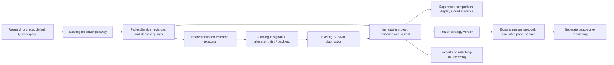

# Q V2 finalization — 5–6 October 2026

## Audit conclusion and target

The supplied brief largely describes capabilities already implemented in Q. The [finalized prompt](v2-finalization-prompt.md) narrows this pass to research integrity, experiment review, navigation and reproducible acceptance. The earlier [architecture audit](audit-architecture.md), [quantitative audit](v2-methodology.md) and [single-strategy guide](single-strategy-lifecycle.md) remain the full subsystem inventory. They are supplemented here, not replaced by another architecture.

Active paths were traced from `Terminal` and `ResearchProjects` through typed transport, gateway/`EngineBridge`, `flagship_api`, project orchestration, `ResearchWorkspace`, Survival and immutable storage. The review also examined data features/models, pipeline result construction, numerical/contract tests, report/export/replay, paper promotion, dependencies, launch/verification scripts, and the browser harness. Historical libraries were inventoried against the existing call-path map; this is not a claim that every retained mathematical model or external integration was independently certified again.

## Lifecycle gaps and missing-module assessment

| Stage | Current path / status | Decision | Priority / effort / value |
| --- | --- | --- | --- |
| Hypothesis | Versioned project thesis, references, reasons | Reuse; make primary entry | P0 / small / coherent research story |
| Data/universe | Exact provider/demo snapshots, quality evidence, reserved segment | Repair recapture boundary; retain selected-universe caveat | P0 / medium / prevents misleading holdout claims |
| Signal/specification | Eight catalogue rules, archived algorithm, five allocation methods | Reuse; arbitrary source remains separate | Existing / high research value |
| Backtest/analytics | Delayed fractional engine; separate funded/share stress; metrics/attribution | Preserve accounting distinctions and numerical tests | Existing / high |
| Validation | HAC, bootstrap, BY, conditional DSR, CSCV; visible unavailable states | Preserve prerequisites and all failures | Existing / high |
| Robustness/regimes | Costs, delay, parameters, subsets, causal rule regimes | Reuse; auxiliary release-time and generic HMM-fit audit deferred | P1 / large / requires new data evidence |
| Portfolio/risk | Caps, volatility controls, equal/inverse-vol/risk-parity/min-variance | Reuse within saved specification | Existing / high |
| Experiment book | Immutable trials/results and decisions; project table exposes only a few metrics | Add comparison of selected attempts and explicit compatibility reasons | P0 / medium / high review/interview value |
| Final retrospective segment | Reveal journal, single access per data hash | Prevent changing a reserved boundary by recapture; detect old conflicting partitions | P0 / medium / high integrity value |
| Freeze/forward | Source-linked freeze, empty/manual or simulated paper registration | Preserve gate/readiness checks; no invented observations | Existing / high |
| Monitoring | Separate historical, OOS and forward metrics | Keep unavailable values; improve refresh/error behavior | P0 / small / operational clarity |
| Export/replay | 21-section report, exact data/source, installed-code replay | Extend canonical acceptance to new comparison | P0 / small / reproducibility |
| Signal Lab | Existing signals/sleeve diagnostics; no complete IC/decay lab | Defer; another page alone does not add evidence | P2 / large / conditional value |
| Live deployment | Disabled; production controls incomplete | Outside V2 | P3 / very large |

No additional strategy engine, database, queue, standalone risk dashboard or optimizer is justified for this release. Secondary daily-template and advanced labs remain reachable under their existing URLs; their conventions are distinct from the canonical project workflow.

## Ordered backlog and acceptance contracts

| Batch | Evidence / problem | Implementation and reuse | Acceptance |
| --- | --- | --- | --- |
| 1 | `capture` derives a new cutoff on every capture; `trials` only compares it with the current spec. Same bytes with a smaller holdout can enter development without `oos_revealed`. | Guard immutable dataset boundaries in existing `ProjectService`, including trial/reveal/freeze paths for older inconsistent records. No data migration/rewrite. | Recapture succeeds with unchanged cutoff; incompatible cutoffs fail and remain journaled; legacy conflicting artifacts cannot be promoted. |
| 2 | Project experiments show return/Sharpe only. Existing version comparison concerns historical versus prospective periods, not alternate attempts. | Project-specific pure presentation adapter over sealed `Project.trials`; reusable `PerformancePlot` and numeric formatting. No new compute service. | 2–4 retained trials; exact dates/data/source/account model required for overlay; fail/pending/missing metrics remain visible; no winner or statistical approval inferred. |
| 3 | Default overview emphasizes market/templates; project fetches can complete after selection changes. | Make project workflow the default; use request ownership and explicit lifecycle guidance/empty/error states. | Existing deep links work; switching/new project cannot be overwritten by an old fetch; canonical flow works in browser. |
| 4 | Previous checks predate this pass. All repository content is currently untracked. | Preserve pre-edit copies in ignored `outputs/finalization-before`; run baseline/final suite and extend existing browser example; export/replay new artifacts. | Required tests/type/build and new regression checks pass; record actual counts and warnings; compare edited files against snapshots. |

## Scope boundary

V2 Core is the finite local research workflow above. A correct blocked paper activation is a successful integrity outcome when a feed is absent; an empty registration is not successful forward performance. Real observed-data studies and elapsed prospective evidence cannot be manufactured to make completion metrics favorable.

V2.1 priorities: point-in-time universe and release-time data, independent observed-data study, fuller signal diagnostics and fresh-environment CI verification. Later broker-paper publishing/reconciliation and production operational controls are P3. Auxiliary feature forward fills, generic HMM fit provenance, differing account conventions, incomplete search-family disclosure, dependency portability and repository-wide lint debt remain explicit limitations until separately verified.

## Implemented result

The four batches are implemented in the existing Q application. No alternate engine, queue, database or broker pathway was introduced. The backend change enforces consistent reservations for identical data; the comparison is a presentation adapter over immutable project evidence. Six new Python cases and eighteen web comparison cases exercise the added contracts.

The five defect cases failed against the prior implementation and passed after the boundary guard; unchanged recapture also passes. Checks cover both smaller/larger reservations before/after reveal, retention of failed tasks and preservation of conflicting historical records. Other projects and different overlapping snapshots remain outside this same-byte guard; they must never be represented as independently untouched history.

The default workspace is now Research projects. A lifecycle cue points to the selected candidate's next review stage. Requests belong to the active project and explicit editor loads cannot be displaced by polling. The OOS panel uses the selected trial's dataset. Monitoring polls while visible and clears stale values after request failure. Both demo and synthetic provider modes are labeled synthetic.

Visual acceptance exposed two additional usability defects: the portfolio layout's desktop overflow rule made long project evidence inaccessible to ordinary scrolling, and an open Codex panel obscured the workspace after shrinking the window. Project layout now retains its own scrolling, the panel closes on the compact breakpoint, and tables constrain their horizontal overflow. The footer no longer asserts engine readiness without checking a service, and the legacy browser-account control states that it does not control systematic paper deployments or brokers.

## Executed verification — 6 October 2026, Asia/Calcutta

| Check | Result |
| --- | --- |
| Python suite | **348 passed**, four existing warnings, 90.41 seconds |
| Web quant and contract suite | **67 passed**, including `tests/quant.test.mjs` and 18 comparison invariants |
| Gateway suite | **39 passed** |
| Total | **454 passed cases**; 24 added in this finalization pass |
| TypeScript | Passed with `--noEmit --incremental false` |
| Production build | Passed; Sites manifest and Vite Sites plugin retained |
| Changed UI/adapter/CLI lint | Passed with zero errors or warnings |
| Full repository lint | **8 pre-existing errors and 9 warnings remain**, recorded separately; not a global lint-clean claim |
| Browser lifecycle | Passed through both trials, retained rejection, comparison, all 18 validation layers, OOS reveal/repeat rejection, freeze, empty forward protocol, monitoring, downloads and reload |
| Browser layout | Desktop scrolling and 900px compact no-overflow assertions passed; screenshots visually reviewed |
| Browser page errors | **0** |
| Export replay | **Verified:** 2 development trials, 1 OOS result and 1 Survival run |

The Python warnings are the existing Starlette/httpx deprecation and pandas warnings in deliberate nonfinite-input cases. The historical Streamlit UI exclusion is unchanged. The production build retains vinext's known route-classification warning. Remaining lint errors are in allocation replay, the retained evidence workspace, project specification text, paper-trading/strategy-development hydration and the integration hook. They are disclosed maintenance work; no new rule suppression hides functional hook errors. The CommonJS browser CLI has a file-local exemption for CommonJS import style.

Actual logs: `outputs/verification/finalization-final-20261006.log`, `finalization-lint-final.json`, and `finalization-browser-final-20261006.log`. The [portable machine-readable record](evidence/v2-finalization-verification.json) records the accepted project and replay outcome. A focused review patch and change fingerprints are in `outputs/verification/finalization-review.patch` and `finalization-changes.json`; pre-edit copies remain in `outputs/finalization-before`. No commit or remote publication is claimed for this untracked checkout.

## Canonical accepted project

The isolated verification preview uses web port **5283**, gateway **5284**, and research/paper stores under `outputs/finalization-runtime`. Normal `start-q21.ps1` continues to use 5273/5274 and the user's ordinary local stores. Installing the code does not copy the isolated verification project into those stores.

- Title: **SYNTHETIC lifecycle browser acceptance 2026-10-05T20:44:18.166Z** (UTC identifier; run accepted on 6 October in Asia/Calcutta).
- Project: `5aa007476fd04651d2f684b918e41b2924eddedbe83f0d541fe38d0c9e44286d`.
- Frozen version: `393512c676b5a31e9faf4f0303884ea0bdff40c3e514f67dd321194cc127c9aa`.
- Files: `outputs/verification/finalization-browser-final-20261006/` contains the Markdown research draft, reproducibility ZIP, replay JSON, summary and inspected screenshots.
- Outcome: **1 PASS / 14 WARN / 0 FAIL / 3 N-A**, overall **WARN**. DSR remains unavailable, no empirical profitability is established, and prospective observations remain **zero**.

The [five-minute demonstration guide](v2-demo-guide.md) covers the intended interview path. The [updated interview material](resume-and-interviews.md) explains the holdout, comparison and operational-boundary trade-offs.

## Completion verdict

The bounded V2 local research core defined in the finalized brief is implemented and passes the verification above. The broader wish list is not a claim of institutional production readiness. Fresh-machine CI, point-in-time/delisting and auxiliary release-time data, broader signal diagnostics, global lint cleanup, authenticated feed operation, elapsed prospective validation and production execution controls remain explicitly deferred. A favorable market strategy and genuine forward track record require new evidence rather than software labels.
